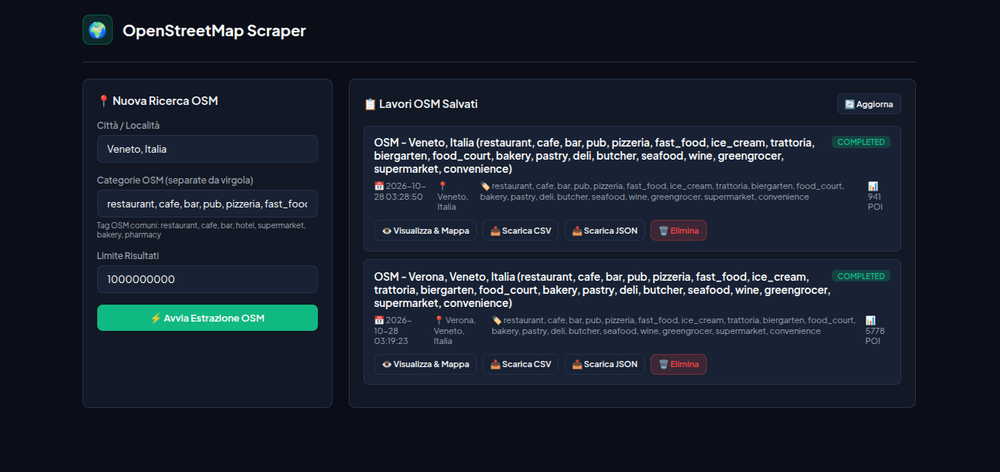
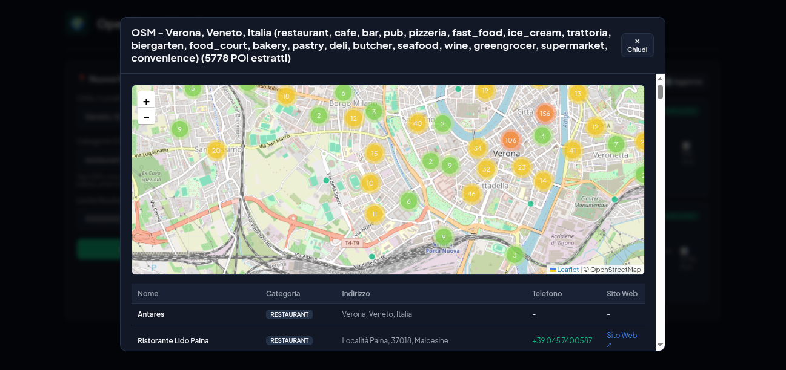

# OpenStreetMap POI Scraper (`osm-scraper`)

Un tool autonomo, leggero e ultra-veloce per l'estrazione massiva di attività commerciali, locali, ristoranti, negozi e punti di interesse direttamente dal database globale di **OpenStreetMap (OSM)** tramite Overpass API e Nominatim, senza necessità di browser, Playwright o scraping pesante.

---

## 📸 Anteprima Interfaccia

### 1. Dashboard & Estrazione OSM
Pannello di controllo pulito per impostare località/città, categorie OSM e massimale di estrazione fino a 1 miliardo di elementi, con elenco dei lavori completati e statistiche sui POI estratti.


### 2. Modale con Mappa Interattiva e Marker Clustering
Mappa interattiva Leaflet con rendering Canvas e clustering intelligente: apre istantaneamente ricerche con oltre 5.000–10.000 punti senza freeze del browser e con tabella anagrafica ordinata.


---

## ✨ Funzionalità Principali

- ⚡ **Velocità Istantanea**: Estrazione via API RESTful in pochi secondi anziché ore di rendering Chromium.
- 📍 **Geocoding & Bounding Box Intelligente**: Risoluzione territoriale su scala comunale tramite Nominatim per query geografiche ad alta densità.
- 🏷️ **Filtro Categorie OSM Completo**:
  - Somministrazione e ristorazione (`amenity=restaurant, cafe, bar, pub, pizzeria, fast_food, ice_cream, trattoria...`).
  - Negozi e artigiani alimentari (`shop=bakery, pastry, butcher, seafood, deli, wine, supermarket...`).
  - Ospitalità e turismo (`tourism=hotel, guest_house, hostel...`).
- 🔄 **Multi-Server Mirror Fallback**: Rotazione automatica con mirror europei ad alta affidabilità per garantire continuità anche in caso di picchi o sovraccarico degli endpoint pubblici.
- 🚀 **Zero-Lag Map Visualizer**:
  - `Leaflet.markercluster` integrato con `preferCanvas: true` per navigare fluidamente a 60fps migliaia di POI contemporaneamente.
  - Paginazione protetta della tabella (primi 200 elementi) per non appesantire la memoria del browser.
- 📥 **Esportazione Immediata**: Download diretto in formato **CSV** e **JSON**.
- 🗑️ **Gestione Lavori**: Eliminazione completa dei job con pulizia istantanea sia da SQLite che dal file system.

---

## 🚀 Avvio Rapido (Docker Compose)

Il progetto è completamente dockerizzato e configurato sulla porta dedicata `8085` per non entrare in conflitto con altri servizi:

```bash
cd osm-scraper
docker compose up -d --build
```

L'interfaccia web sarà disponibile all'indirizzo:
👉 **`http://localhost:8085`**

Per visualizzare i log:
```bash
docker compose logs -f
```

Per arrestare il servizio:
```bash
docker compose down
```

---

## 📁 Struttura della Repository

```text
├── app.py                 # Backend Flask + Web UI reattiva integrata
├── Dockerfile             # Immagine Python 3.11-slim leggera
├── docker-compose.yaml    # Configurazione di avvio container sulla porta 8085
├── requirements.txt       # Dipendenze minime (Flask, requests)
├── data/                  # Volume con database SQLite (osm_jobs.db) e file esportati
└── docs/screenshots/      # Screenshot dell'interfaccia per la documentazione
```

---

## 💡 Esempio Categorie per il Settore Ristorazione & Food

Per estrarre tutti i locali food & beverage in una città, incolla questa lista nel campo categorie:

```text
restaurant, cafe, bar, pub, pizzeria, fast_food, ice_cream, trattoria, biergarten, food_court, bakery, pastry, deli, butcher, seafood, wine, greengrocer, supermarket, convenience
```

---

## Licenza
MIT
